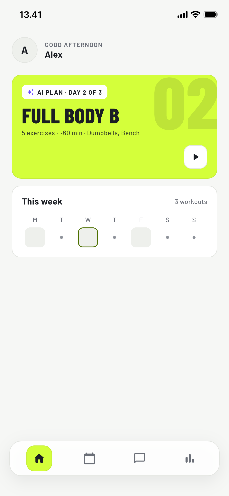
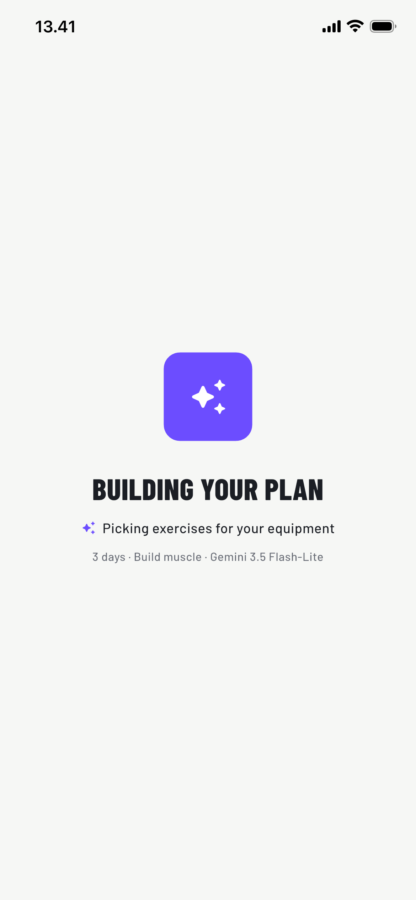
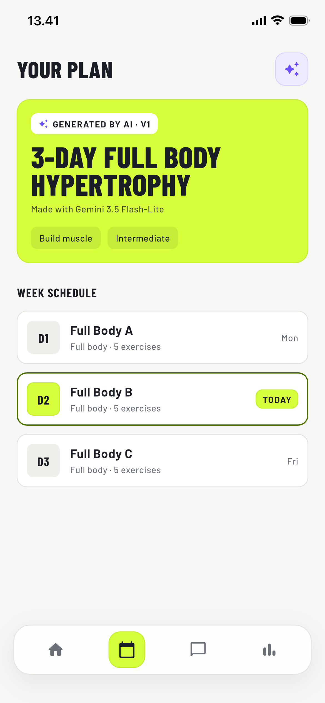
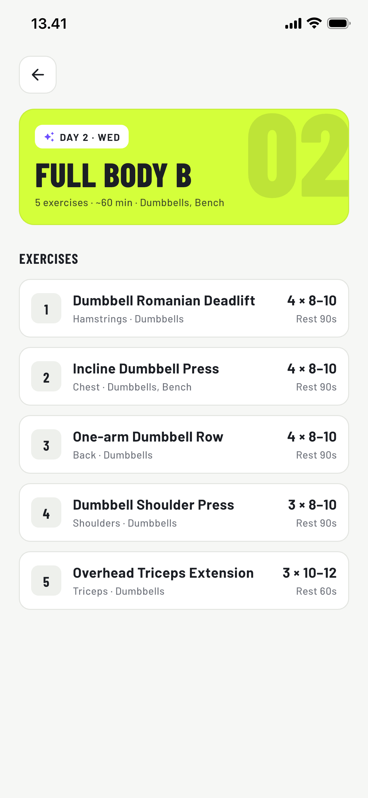
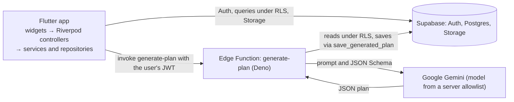

# Repmind

[](https://github.com/hafid-firman-febrian/Repmind/actions/workflows/ci.yml)

**An AI fitness coach app built with Flutter, Supabase, and Google Gemini.** Repmind turns a user's goal, level, equipment, and training days into a structured weekly workout plan, and revises it from plain-language requests.

> Portfolio project. The AI Workout Generator is complete. The AI Coach Chat and progress tracking come next (see [Roadmap](#roadmap)).

## Screenshots

| Home | Generating | Plan | Workout day |
| --- | --- | --- | --- |
|  |  |  |  |

## Features

- **AI weekly plan.** Gemini builds a plan from the user's goal, level, equipment, and days per week, using only exercises from a curated catalog that matches the user's equipment.
- **Adjust in plain language.** "More core work", "Shorter sessions", or anything else: the AI revises the current plan into a new version (v1 → v2 → …) and archives the previous one.
- **Model choice per user.** Users pick a Gemini model in Profile. The server maps that choice to a model ID from an allowlist.
- **Today at a glance.** Home shows today's (or the next) workout and the week's schedule.
- **Accounts.** Email and password sign-up, onboarding (goal, level, schedule, equipment, height, and weight), and a profile with photo upload.

## Architecture



Generating a plan: the app calls the `generate-plan` Edge Function with the user's JWT. The function reads the profile, the exercise catalog filtered to the user's equipment, and, for an adjustment, the active plan, all under row-level security. It sends Gemini a prompt and a JSON Schema, validates the reply with zod, retries once with the list of errors if the reply is invalid, and saves the plan through the `save_generated_plan` Postgres function, which archives the previous version in the same transaction.

## Key technical decisions

- **AI stays on the server.** The app holds no AI API key, prompt, or model ID. It stores only a model key such as `gemini_flash_lite` on the profile, and the Edge Function maps it to a real model through `supabase/functions/_shared/ai_models.ts`.
- **AI output is never trusted as-is.** The JSON Schema fixes the number of days. zod checks the structure, sets, reps, and rest, and that every exercise ID exists in the user's catalog. An invalid reply gets one retry with the errors listed, and the plan is saved atomically by one Postgres function.
- **Row-level security on every table**, with pgTAP tests proving that one user cannot read or change another user's data.
- **The Edge Function runs as the user.** It forwards the user's JWT instead of using the service role, so RLS still applies.
- **Feature-first layers** (`data → domain → application → presentation`). Third-party exceptions become a `sealed class AppException` inside repositories, and business rules live in pure functions and services.
- **Design tokens** through `ThemeExtension` (colors, type scale) and radius constants. Widgets contain no hardcoded visual values.

## Tech stack

| Layer | Tools |
| --- | --- |
| App | Flutter 3.44.2+ (Dart 3.12.2+), Riverpod 3 with code generation, go_router |
| Backend | Supabase: Auth, Postgres with RLS, Storage, Edge Functions |
| AI | Google Gemini through `@google/genai` (structured JSON output), validated with zod, in a Deno Edge Function |
| Tests | flutter_test and mocktail, pgTAP, Deno test |
| CI | GitHub Actions: format, analyze, and tests for the app and the Edge Functions |

## Testing

| Suite | Command | Tests |
| --- | --- | --- |
| Flutter (unit and widget) | `flutter test` | 228 |
| Database (pgTAP: RLS, RPC, catalog) | `supabase test db` | 48 |
| Edge Functions (Deno) | `deno test --allow-all --no-config supabase/functions/` | 45 |

CI runs `dart format`, `flutter analyze`, `flutter test`, `deno fmt --check`, `deno check`, and `deno test` on every push. The pgTAP suite runs locally because it needs the Supabase Docker stack.

`--no-config` stops Deno from picking up a `package.json` or `deno.json` from a parent directory.

## Run locally

Prerequisites: Flutter 3.44.2 or newer (Dart 3.12.2+), Docker, the Supabase CLI, Deno 2, and a Gemini API key from Google AI Studio.

Backend (with Docker running):

```bash
supabase start
supabase db reset
cp supabase/functions/.env.example supabase/functions/.env   # then set GEMINI_API_KEY
supabase functions serve
```

App (in a second terminal):

```bash
cp env/example.json env/dev.json   # then set SUPABASE_PUBLISHABLE_KEY from `supabase status`
flutter pub get
dart run build_runner build --delete-conflicting-outputs
flutter run --dart-define-from-file=env/dev.json
```

Sign in with the local demo account `demo@repmind.dev` / `repmind-demo`, created by `supabase/seed.sql`. With a free-tier Gemini key, switch to **Gemini 3.5 Flash-Lite** before generating (tap the avatar on Home → AI model). On the Android emulator, set `SUPABASE_URL` to `http://10.0.2.2:54321`.

## Project structure

```
lib/
  core/              config, router, theme tokens, errors, shared widgets
  features/
    auth/ onboarding/ profile/ home/ plan/
                     split into data, domain, application, and presentation layers as needed
supabase/
  migrations/        schema, RLS policies, exercise catalog, save_generated_plan
  functions/
    _shared/         model allowlist, Gemini client, HTTP helpers
    generate-plan/   request, schedule, schema, validation, prompt, handler
  tests/             pgTAP tests
  seed.sql           local demo account
```

## Roadmap

- **AI Coach Chat:** a streaming chat that knows the user's goal and current plan.
- **Tracker and progress:** session logging, streaks, and weekly volume charts.
- **Google Sign-In:** the button and auth flow are in the app; the provider setup is pending.
